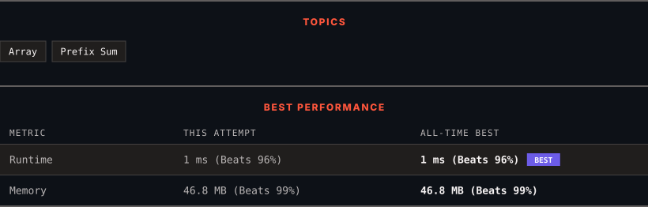

<div align="center">

# 724. Find Pivot Index

      

[](https://leetcode.com/problems/find-pivot-index/)

</div>

---

<div align="center">

<picture>
  <source media="(prefers-color-scheme: dark)" srcset="panel-dark.svg">
  <source media="(prefers-color-scheme: light)" srcset="panel-light.svg">
  
</picture>

</div>

> **New personal best** — Runtime improved on this submission.

### HOW IT WENT

| | |
|:--|:--|
| **Attempts** | first try |
| **Time to solve** | under a minute |
| **Verdicts** | ✅ Accepted |

---

### NOTES

_No notes yet._

---

### SOLUTIONS (1)

| # | File | Language | Date |
|:-:|------|:--------:|:----:|
| 1 | [sol1.java](./sol1.java) | `Java` | 2026-10-14 ← **latest** |

---

### PROBLEM DESCRIPTION

Given an array of integers `nums`, calculate the **pivot index** of this array.

The **pivot index** is the index where the sum of all the numbers **strictly** to the left of the index is equal to the sum of all the numbers **strictly** to the index's right.

If the index is on the left edge of the array, then the left sum is `0` because there are no elements to the left. This also applies to the right edge of the array.

Return *the **leftmost pivot index***. If no such index exists, return `-1`.

 

**Example 1:**

```

**Input:** nums = [1,7,3,6,5,6]
**Output:** 3
**Explanation:**
The pivot index is 3.
Left sum = nums[0] + nums[1] + nums[2] = 1 + 7 + 3 = 11
Right sum = nums[4] + nums[5] = 5 + 6 = 11

```

**Example 2:**

```

**Input:** nums = [1,2,3]
**Output:** -1
**Explanation:**
There is no index that satisfies the conditions in the problem statement.
```

**Example 3:**

```

**Input:** nums = [2,1,-1]
**Output:** 0
**Explanation:**
The pivot index is 0.
Left sum = 0 (no elements to the left of index 0)
Right sum = nums[1] + nums[2] = 1 + -1 = 0

```

 

**Constraints:**

	- `1 <= nums.length <= 10^4`

	- `-1000 <= nums[i] <= 1000`

 

**Note:** This question is the same as 1991: [https://leetcode.com/problems/find-the-middle-index-in-array/](https://leetcode.com/problems/find-the-middle-index-in-array/)

---

<div align="center">

<sub>Auto-synced by <strong>LeetSync</strong> · Built by <a href="https://deveshsamant.in/">Devesh Samant</a></sub>

</div>
